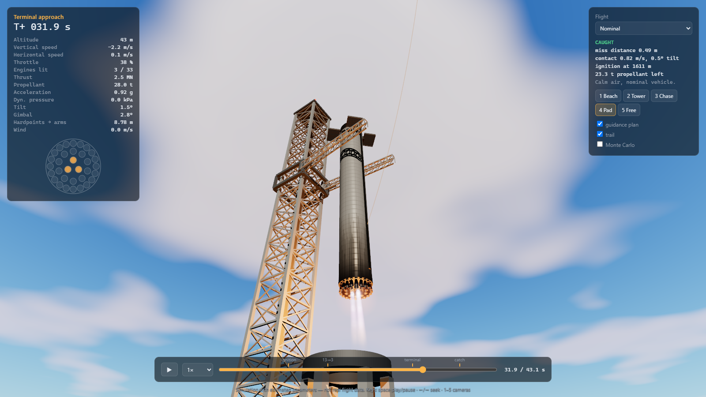
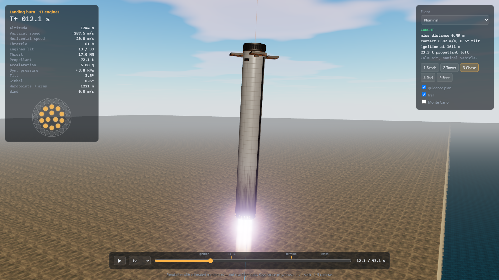
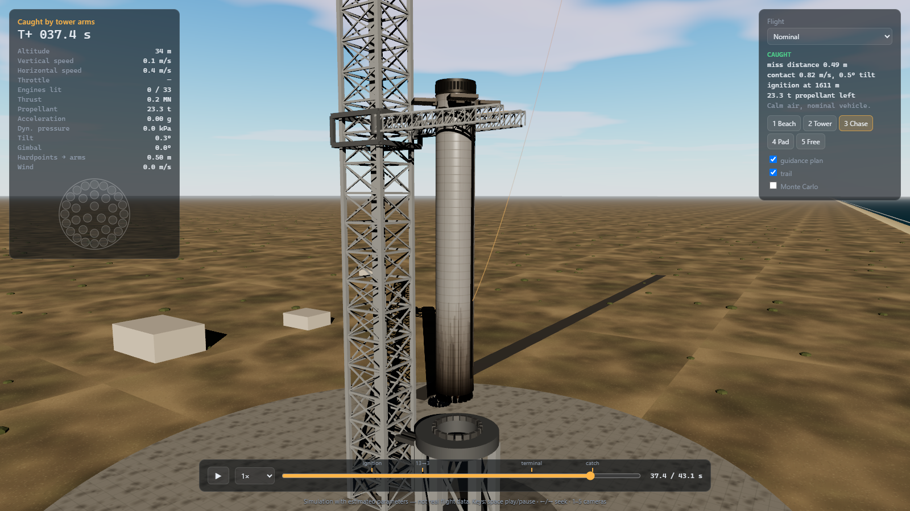

# Booster Catch Simulation

A simulation (not a game) of a large reusable rocket booster returning to its launch site and being
caught in mid-air by two arms on the launch tower. The Python simulator flies the booster with the
same family of steering math that real engineers have published: convex-optimization
powered-descent guidance. The 3D viewer in your browser replays each recorded flight.

> **Estimates, not real data.** Real flight software and vehicle parameters are proprietary. This
> project uses the published guidance method together with approximate public figures and
> engineering estimates (see [What is real and what is estimated](#what-is-real-and-what-is-estimated)).
> The vehicle and tower are generic models with no logos or names, and the project has no affiliation
> with any company.



| Landing-burn ignition, 13 engines | Caught and held by the arms |
|---|---|
|  |  |

## Results

60 Monte Carlo flights, each with random start position and velocity, wind and gusts, and thrust,
Isp and aerodynamic errors that the guidance does not know about (`python -m sim.run --mc 60`):

| Metric | Mean | 95th percentile | Worst |
|---|---|---|---|
| Caught | **60 / 60** | | |
| Hardpoint miss distance | 0.65 m | 1.42 m | 2.91 m |
| Sink rate at contact | 0.76 m/s | 1.07 m/s | 1.24 m/s |
| Tilt at contact | 1.1° | 2.7° | 3.97° |
| Landing-burn ignition altitude | 1620 m | | |
| Peak deceleration | 6.1 g | | |
| Propellant left (of 75 t) | 21.2 t | | 0.0 t (one run) |

A catch counts only if the hardpoints land within ±4 m along the arms and ±1.5 m across them,
with a sink rate under 3 m/s and tilt under 4°. Two results are marginal: the worst tilt (3.97°)
is just inside that limit, and one windy run had to hover so long before lining up that it landed
with its propellant tank essentially empty. A real flight would treat both as failures of margin.

Showcase flights shipped with the viewer:

| Flight | Miss distance | Contact |
|---|---|---|
| Nominal (calm) | 0.49 m | 0.82 m/s, 0.5° |
| Windy (12 m/s, gusts) | 0.31 m | 0.80 m/s, 2.6° |
| Dispersed A | 1.46 m | 0.49 m/s, 2.2° |
| Dispersed B | 0.10 m | 0.78 m/s, 0.1° |

## How it works

```
 coast (grid fins)  ->  ignition planner  ->  landing burn: guidance re-plans every 0.25-0.5 s
                                              13 engines -> 3 engines, LQR tracks the plan
                    ->  terminal descent onto the arms  ->  arms close, booster held
```

**Physics** ([sim/dynamics.py](sim/dynamics.py), [sim/engines.py](sim/engines.py),
[sim/environment.py](sim/environment.py)). The booster is a rigid body with six degrees of freedom:
position, velocity, attitude quaternion and body rates, plus mass. The model is integrated with
RK4 at 100 Hz and includes:
- 33 engines, each with its own ignition ramp and throttle lag, plus a rate- and angle-limited gimbal.
- Exponential atmosphere, axial drag, and crossflow normal force with its centre of pressure.
- Reduced drag while the plume shields the base.
- Grid fins whose authority scales with dynamic pressure.
- A power-law wind profile with random gusts.

**Guidance** ([sim/guidance.py](sim/guidance.py)). This is lossless convexification
(Açıkmeşe & Ploen 2007; Blackmore, Açıkmeşe & Scharf 2010). Writing thrust as acceleration
`u = T/m` with a slack `σ ≥ |u|` and `z = ln m` turns the non-convex thrust limits into
second-order-cone constraints. The problem is built once with cvxpy parameters and re-solved by
Clarabel in a few tens of milliseconds. Additions on top of the textbook problem:
- Time-varying thrust bounds for the 13 → 3 engine switch.
- Drag and crosswind along the previous plan, fed in as a known acceleration.
- A tilt limit, a 60° glide-slope cone, and keep-out of the tower side.
- A final-approach funnel with speed and tilt caps.
- A lateral-jerk limit matched to how fast the vehicle can actually rotate.
- Soft constraints, so a disturbed state still gets a plan that ends at the arms.

The ignition time is chosen by searching for the latest ignition that is still feasible, with
throttle margin held back. Re-plans use the same conservative limits so that the tracking loop
always keeps authority in both directions.

**Control** ([sim/control.py](sim/control.py)). An LQR controls each lateral axis through the
engine gimbal. Its state is position, velocity, tilt and tilt rate, and its model includes:
- the gimbal's own sideways push, which is large on a long booster whose centre of mass sits near
  the engines;
- aerodynamic normal force and restoring moment.

Gains are recomputed with the Riccati equation as thrust, mass and dynamic pressure change. In the
last metres, a terminal law slows the sink rate until the hardpoints line up, and integral action
trims out unknown wind.

**Things that went wrong on the way**, because they explain the design:
- The fuel-optimal plan is bang-bang, so it leaves no margin. Every re-plan used up the margin
  again until the planner was made to keep its conservative limits.
- At hover thrust, a gimbal push big enough to rotate the booster also shoves it sideways at
  about 2 m/s². Separate attitude and position loops oscillated; the joint LQR fixed it.
- Just before the forced 13 → 3 engine switch, the relaxation is not tight (σ > |u|). This is the
  textbook case where the lossless guarantee does not apply. The tests check tightness only where
  the theory holds.

## Running it

Requirements: Python 3.14 and Node 24 or later.

```bash
# simulation
python -m venv .venv
.venv/Scripts/activate            # Windows (macOS/Linux: source .venv/bin/activate)
pip install -r requirements.txt
pytest                            # physics, guidance and closed-loop catch tests (~1 min)
python -m sim.run --mc 60         # writes viewer/public/flights/*.json and results/monte_carlo.json

# viewer
cd viewer
npm install
npm run dev                       # open the printed localhost address
```

Viewer controls:
- Space: play or pause. ← and →: seek one second.
- 1–5: cameras (Beach telephoto, Tower, Chase, Pad, Free orbit). H: hide the overlay.
- URL options such as `?flight=windy&t=30&cam=pad&play=0` open a specific moment.
- `npm run shots` renders key moments to PNG with a headless browser. Run
  `npx vite preview --port 4173` first.

## Project layout

```
sim/       vehicle.py  dynamics.py  environment.py  engines.py
           guidance.py control.py   flight.py       scenario.py  run.py
tests/     test_dynamics.py  test_guidance.py  test_catch.py
viewer/    src/scene     booster, tower + arms, site (ocean, beach, pad), sky and lighting
           src/effects   plume shader, smoke/steam particles, bloom
           src/playback  flight file loading and interpolation
           src/ui        telemetry, timeline, cameras, Monte Carlo plot
results/   monte_carlo.json
```

## What is real and what is estimated

| Item | Status |
|---|---|
| Guidance method (lossless convexification, SOCP) | Published method, implemented from the papers |
| LQR, Riccati gains, RK4 rigid-body dynamics | Standard engineering methods |
| Booster size (9 m × 71 m), 33 engines with 13 gimballed and 13 → 3 landing | Public descriptions |
| Engine thrust (~2.26 MN) and sea-level Isp (~327 s) | Approximate public figures |
| Dry mass 255 t, landing propellant 75 t, 35% min throttle, 15° gimbal, 45°/s gimbal rate | Estimates |
| Aerodynamic coefficients, centre of pressure, grid-fin effectiveness, plume drag reduction | Estimates |
| Tower height (146 m), arm geometry and catch height | Approximate and simplified |
| Start dispersions (σ 60 m, 5 m/s after boostback), wind up to 14 m/s | Assumptions |
| Atmosphere, flat Earth, rigid vehicle (no slosh, no flex), catch contact | Simplified models |

## References

- B. Açıkmeşe, S. R. Ploen, "Convex Programming Approach to Powered Descent Guidance for Mars
  Landing," *Journal of Guidance, Control, and Dynamics*, 30(5), 2007.
- L. Blackmore, B. Açıkmeşe, D. P. Scharf, "Minimum-Landing-Error Powered-Descent Guidance for
  Mars Landing Using Convex Optimization," *JGCD*, 33(4), 2010.
- L. Blackmore, "Autonomous Precision Landing of Space Rockets," *The Bridge* (NAE), 46(4), 2016.
- cvxpy (Diamond & Boyd), the Clarabel interior-point solver, and three.js.
